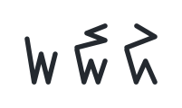
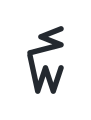
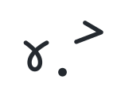
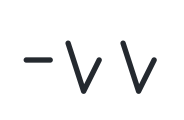
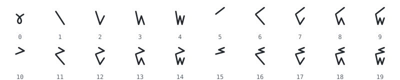

# kaktovik-numerals

Render any number as [Kaktovik numerals](https://en.wikipedia.org/wiki/Kaktovik_numerals): SVG with zero dependencies, plus PNG, JPEG and WebP through [sharp](https://sharp.pixelplumbing.com/).

**[Docs and playground](https://karlnorling.github.io/kaktovik-numerals/)** · [Storybook](https://karlnorling.github.io/kaktovik-numerals/storybook/)

| Package                                                           | What it does                                     |
| ----------------------------------------------------------------- | ------------------------------------------------ |
| [`@kaktovik-numerals/core`](packages/@kaktovik-numerals/core)     | Numbers to SVG. No dependencies, runs anywhere.  |
| [`@kaktovik-numerals/raster`](packages/@kaktovik-numerals/raster) | Numbers to PNG, JPEG or WebP in Node, via sharp. |
| [`@kaktovik-numerals/cli`](packages/@kaktovik-numerals/cli)       | The `kaktovik` command.                          |

<p>
  
  
  
  
</p>
<p>
  
  
</p>

Kaktovik numerals were invented in 1994 by middle-school students in Kaktovik, Alaska, to write the base-20 counting of the Iñupiaq language. Each digit shows its value: up to three fives across the top, and up to four units as a zigzag below, with the fives drawn as the units turned on their side. Unicode added them in 2022.



## Usage

```sh
npm install @kaktovik-numerals/core
```

```js
import { toSvg } from '@kaktovik-numerals/core';

const svg = toSvg(1993);
const red = toSvg(1993, { size: 200, color: '#c00', background: 'white' });
```

```sh
npm install @kaktovik-numerals/raster
```

```js
import { toImage } from '@kaktovik-numerals/raster';
import { writeFile } from 'node:fs/promises';

await writeFile('1993.webp', await toImage(1993, { format: 'webp', size: 400 }));
```

### Command line

```sh
npx @kaktovik-numerals/cli 1993 > 1993.svg
npx @kaktovik-numerals/cli 0.5 -o half.webp --size 200
npx @kaktovik-numerals/cli -42 -o minus.png
```

Installed globally (`npm install -g @kaktovik-numerals/cli`), the command is `kaktovik`. Run `kaktovik --help` for every option.

### Colours and gradients

`color` and `background` take any CSS colour, or a CSS gradient: `linear-gradient()`, `radial-gradient()` and their `repeating-` forms. A gradient spans the whole image.

```js
// Rainbow
toSvg('1234567', {
  color: 'linear-gradient(to right, #e03131, #f76707, #fab005, #40c057, #228be6, #7048e8, #be4bdb)',
});

// Christmas
toSvg('2026.1225', {
  color: 'repeating-linear-gradient(135deg, #e03131 0 3%, #ffffff 3% 6%)',
  background: 'radial-gradient(#2b8a3e, #0b3d20)',
});
```

## Numbers the Kaktovik students didn't write

Kaktovik numerals are positional in base 20 with a zero, so whole numbers of any size need no extension. This library adds:

| Input  | Drawn as                | Rule                                                                   |
| ------ | ----------------------- | ---------------------------------------------------------------------- |
| `20`   | 1, 0                    | Places count in twenties, most significant first.                      |
| `0.5`  | 0, a dot, 10            | A dot on the baseline starts the fraction, which continues in base 20. |
| `0.01` | 0, a dot, 0, 4          | Every decimal fraction is exact in base 20, so nothing is rounded.     |
| `-42`  | a minus sign, then 2, 2 | A minus sign before the number.                                        |

The dot and the minus sign are this library's choice; the students' system doesn't prescribe them.

Inputs can be a `number`, a `bigint` or a decimal `string`. A number is first written in its shortest exact form, so `0.1` draws as `0.1`. Strings and bigints keep every digit.

## API

### `toSvg(value, options?)` → `string` from `@kaktovik-numerals/core`

| Option        | Default        | Notes                                                                |
| ------------- | -------------- | -------------------------------------------------------------------- |
| `size`        | `100`          | Image height in pixels. The width follows from the number of places. |
| `color`       | `currentColor` | Stroke colour. Takes a colour or a gradient.                         |
| `background`  | none           | Colour or gradient behind the numeral.                               |
| `gap`         | `10`           | Space between places, in viewBox units.                              |
| `padding`     | `20`           | Space around the numeral, in viewBox units.                          |
| `strokeWidth` | `4.5`          | Stroke width in viewBox units, where a digit is 60 tall.             |
| `title`       | the number     | Accessible name. `false` leaves it out and sets `aria-hidden`.       |

### `toImage(value, options?)` → `Promise<Buffer>` from `@kaktovik-numerals/raster`

Takes every `toSvg` option, plus `format` (`png`, `jpeg`, `jpg` or `webp`; default `png`) and `quality` (1–100). Colours default to black. JPEG gets a white background unless you pass one.

### Lower level, from `@kaktovik-numerals/core`

- `parse(value)` → `{ negative, integer, fraction }`: the base-20 digits that get drawn.
- `format(parsed)` → the canonical decimal string, e.g. `-12.5`.
- `digitSvg(digit, place?, options?)` → one digit on its own.
- `parseGradient(css)` → the object form of a CSS gradient string, or `undefined` for a plain colour.
- `digitStrokes(digit)` → the strokes of one digit as SVG path data, for drawing somewhere else.

## Development

```sh
yarn install
yarn test        # all packages, straight from source
yarn build       # core, then raster, then cli
yarn docs        # docs site with the playground, on localhost:4322
yarn storybook   # Storybook on localhost:6006
yarn examples    # regenerate examples/
```

## License

MIT
